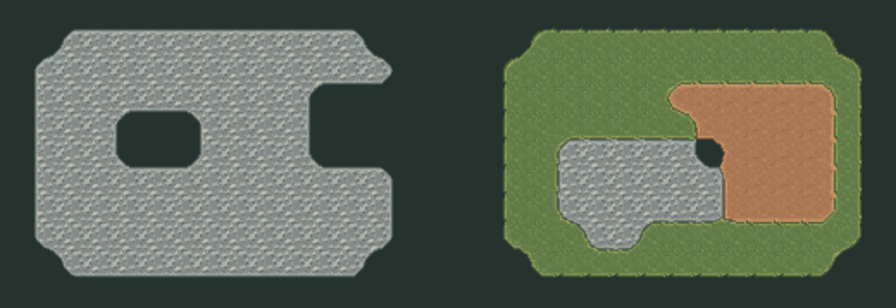

# Aseprite + Tiled 瓦片制作技能

给 AI 的一套本地工作流程：用 **Aseprite** 绘制可编辑的像素瓦片，用 **Tiled** 整理普通图块、示例图章和能在空白地图直接起刷的地形集。不绑定任何游戏项目或引擎。

## 交给你的 AI

1. 下载仓库 ZIP 后完整解压，或克隆仓库；保留 `SKILL.md`、`references/` 和 `assets/` 的相对位置。不要只复制 `SKILL.md`。
2. 把这个目录加入 AI 可以读取的工作区；如果你的 AI 客户端支持技能，也可以按该客户端的说明导入整个目录。
3. 给 AI 你的素材目录（没有素材就写「从零画」）、期望的瓦片尺寸、地形与接边关系，以及可写入的输出目录。示例提示词：

> 先读 `aseprite-tiled-tileset/SKILL.md`（若目录名不同，读取解压目录根部的 `SKILL.md`），按任务选读它链接的参考。请从零用 16×16 像素格制作草地和泥土：泥在中心，草在外缘，外围接透明空白；输出目录是 `输出目录`。先确认你能访问的文件和本地工具，再交付分层原稿、PNG、外部 TSX 和展示 TMX。另开全空地图，只添加 TSX，实刷同层接边和地形擦除；不能操作编辑器就明确列出未验项。

如果已有素材，把「从零」改成「只整理我提供的 PNG/TSX/TMX，不改像素，缺少过渡就列出来」，并附上素材路径。

不支持技能的 AI 也可以读这些文档。纯网页聊天若不能浏览目录，上传 `SKILL.md`、需要的参考和输入素材即可请它给方案或审查；仅发仓库链接不能赋予它本机文件权限，也不能代替它运行编辑器。

## 使用条件

| 要做什么 | 需要什么 |
| --- | --- |
| 了解方法、检查可以读取的素材、列出缺项 | AI 能读取相关文档和输入文件；无需本地编辑器。 |
| 实际生成或修改输出文件 | AI 或你本人能写入指定输出目录；保持素材的相对路径。 |
| 从零画或补画，并交付可编辑分层原稿与 1× PNG | 安装 Aseprite，由 AI 通过可用的本地工具操作，或由你手动操作。没有 Aseprite 时仍可整理现有素材，但不要声称已在 Aseprite 绘制或导出。 |
| 打开展示地图、编辑图块集并完成 Terrain 实刷 | 安装有 Terrain Sets / Terrain Brush 的 Tiled；AI 需要桌面操作能力，或由你手动实刷。只有命令行或文件读写时，可以检查引用和规则，不能声称界面验收通过。 |

随附样例曾用 Aseprite 1.3-beta14-arm64 重导出，用 Tiled 1.11.2 读取；作者也已确认在 Tiled 中实刷过样例。这里列出的是已检查过的环境，不是最低版本承诺。无需插件、AutoMap、Unity、账户、API Key 或额外脚本；下载后可离线处理。

## 先试随附样例

- [展示地图](assets/grass-and-dirt/showcase.tmx)：在 Tiled 打开，看普通图块、2×2 图章、泥心草边和碎石四方交汇。顶部有一层空白练习层。
- [分层源稿](assets/grass-and-dirt/tiles.aseprite) 和 [PNG 图集](assets/grass-and-dirt/tiles.png)：适合对照每种接边是怎么画出来的。
- [外部 TSX](assets/grass-and-dirt/tiles.tsx)：新建一张 **16×16 像素格**的正交地图，只添加该 TSX；在未锁定的全空图块层选择「草地、泥土与碎石 · 同层接空白」。直接用地形刷画草、在内部刷泥并延到透明边，再试碎石和地形擦除。**目标是证明新地图能刷，不是证明展示图看起来正常。**

AI 的入口是 [SKILL.md](SKILL.md)，细节分为 [Aseprite 绘制与补画](references/aseprite-authoring.md) 和 [Tiled 整理与验收](references/tiled-organization.md)。

## 授权

仓库的文档和 AI 辅助制作的样例素材采用 [CC0 1.0](LICENSE)：可复制、修改、再分发及商用，不要求署名。Aseprite、Tiled 软件及其商标不在此授权范围内。
