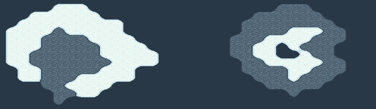

# 雪地与岩地：两个辅助库怎么一起用

这套 24×16 示例用雪地、岩地和透明空白，覆盖 `3⁴ − 1 = 80` 种非全空角点组合。它不是新的通用引擎：可复用的是 Lua 网格／像素操作和 Python Wang 转换；配色、纹理、场景摆法只属于这套示例。



- [Aseprite 分层原稿](../../assets/snow-and-rock/tiles.aseprite) · [PNG 图集](../../assets/snow-and-rock/tiles.png)
- [Tiled 外部 TSX](../../assets/snow-and-rock/tiles.tsx) · [展示 TMX](../../assets/snow-and-rock/showcase.tmx)

## 共用清单

[tiles.tsv](tiles.tsv) 第一行是格宽、格高和图集列数；其余数据是本地图块 ID 和四个角（左上、右上、右下、左下）。`0` 表示这里确实要透明，`1` 是雪、`2` 是岩。全空由地图空格承担，不占用图集槽。行序决定槽位，已有地图引用这套 TSX 后不要随意重排 ID。

[draw.lua](draw.lua) 用 Lua 库按格落到雪地／岩地两层并导出；[build.py](build.py) 用 Python 库把具名四角写成 Tiled 顺序，并按同一批签名拼出展示图。这里没有分别维护另一份图块与触点的对照表，也没有从 PNG 猜材质。

## 重建与验证

需要 Aseprite 和 Python 3.10+；重建不需要额外 Lua 或 Python 包。先准备一个空输出目录，从仓库根目录执行。`aseprite` 指 Aseprite 可执行文件；把 `<OUTPUT>` 换成已创建的输出目录，两条命令用同一个值：

```text
aseprite -b --script-param "helpers=scripts/aseprite" --script-param "manifest=examples/snow_and_rock/tiles.tsv" --script-param "output=<OUTPUT>" --script examples/snow_and_rock/draw.lua
python3 -B -m examples.snow_and_rock.build --output "<OUTPUT>"
```

预览图是 Tiled 渲染结果，不是构建输入。样例已做 Aseprite 原稿回导、像素接边检查和 Tiled 命令行解析。**编辑器实刷未在本示例执行。** 若要确认刷子行为，在 Tiled 另建 **24×16 像素格**的空地图、只加该 TSX，实际刷雪和岩、让边缘接空白并用地形擦除，不用展示图替代验收。
